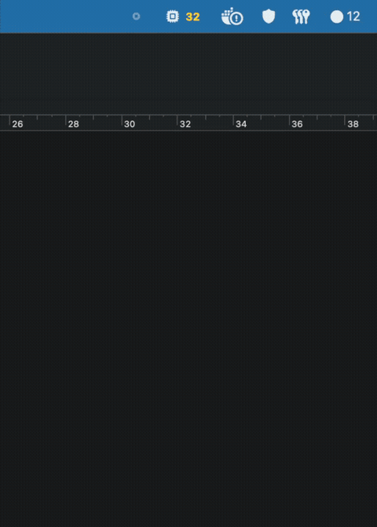

# Pidlyse

  

  

Native macOS menu bar app that spots stray dev processes and clears them in one click.

Sits beside the clock. Periodically scans for known process junk — orphaned test runners, idle servers, stale playwright-mcp instances, zombie Chrome helpers — and badges the icon when it finds them. Click to expand: a categorised list with per-row CPU%, RAM, and age; risk-tier color dots; kill buttons for obvious strays; and a "Needs review" section for anything that warrants a second look.

## Features

- **19 process kinds** detected: `pytest`, `vitest`, `vite`, `jest`, `npm`, `docker`, `uvicorn`, `playwright`, `playwright-mcp`, `Chrome (playwright-mcp)`, `bun`, `node`, `Next.js`, `Astro`, `cargo`, `go run`, `Electron (dev)`, `LLM server`, `MCP server`
- **Per-row signals** — the owning project (the git repo / working directory the process runs in, e.g. `bidviz` or `bidviz/frontend`, shown as the row label so a bare `npm`/`node` is identifiable; full path on hover), CPU%, RAM, age, risk-tier color dot (green / orange / red), expandable "why is this here?" inspector (tty status, orphan flag, age criteria, a sustained-low-CPU "idle dev server" signal, the full command line, and provenance hints: the registered port it listens on, its full parent chain up to launchd, the Docker container that owns it, and its open files + sockets)
- **One row per logical process** — chains that live and die together (`npm run dev` → `vite`, `uv run` → uvicorn, `next dev` → `next-server`, playwright-mcp → its Chrome helpers) show as a single row with a ×N count; its kill takes down and verifies every member, and the ⓘ inspector lists them
- **Two-section layout** — *Safe to clean* (easy-tier orphaned/old/no-tty strays, with a "~X MB reclaimable" footprint total in the section header) and *Needs review* (ambiguous processes tied to real dev infra)
- **"Clean all"** sweeps the safe section in one click; per-row kill button for surgical cleanup
- **Honest kill feedback**: a killed row shows `killing…`, then what actually happened: `gone`, `respawned`, `didn't die`, `can't kill`, or `skipped`. "Clean all" reports the tally (e.g. `Cleaned 4 of 6 · 1 respawned · 1 didn't die · 1.2 GB reclaimed`), and the URL scheme, Shortcuts, and `pidlyse clean` use the same line.
- **Protect a project** — click 🔒 on a safe row to keep that project's processes out of "Clean all" (they stay listed and individually killable); one click un-protects
- **Right-click a row** for quick actions — copy the PID, the full command line, or a ready-to-paste `kill <pid>`, and reveal the process's working directory in Finder (clipboard / Finder only, no extra shell-out)
- **Keyboard & dismissal** — ⌘⌫ kills the sole sweepable safe row when exactly one is shown (protected rows excluded); Esc or a click outside dismisses the popover (it takes keyboard focus on open)
- **Quick filter** — a search field on the Processes tab narrows the list live by command, owning project, or listening port; session-scoped, clears when the popover closes
- **Session dismiss** — hide a process until restart without killing it (↺ rescan restores all dismissed items)
- **Docker containers tab** — a Processes / Containers / Cleaned segmented toggle in the popover; the Containers tab lists running containers (name, image, status, ports, and a one-shot CPU/memory sample fetched on load/refresh) grouped under per-compose-project section headers (non-compose containers ungrouped), with per-row **restart**, **stop**, and **stop + remove** buttons, and a clear empty state when Docker isn't installed
- **Cleaned tab** — persistent value from your confirmed kills: this-week stats (how many cleaned, estimated RAM reclaimed, top stray kinds) above a newest-first "Recently cleaned" list; privacy-first (kind, project label, RAM, and time only — never the command line)
- **Kill flow**: SIGTERM first, SIGKILL fallback after 2 s — always explicit, never automatic
- **Settings**: scan interval (default 2 min), stale-process threshold (default 30 min), ignored command substrings (optionally scoped to one project tree with ` @ ~/path`), custom detection rules (one command substring → a friendly label; always Needs Review), protected projects (kept out of "Clean all"), per-kind scan toggles (switch off whole process categories), launch at login, notification alerts (opt-in)

## Requirements

- macOS 14+
- Xcode 15+
- Apple Silicon (M-series) target

## Build & Run

Open `Pidlyse.xcodeproj` in Xcode and run (⌘R). The app lives in the menu bar — no Dock icon (`LSUIElement = YES`). Left-click the icon to open the popover; right-click (or two-finger tap) for a quick Quit menu.

Run the test suite from the command line with `make test`. The same suite runs automatically on every push to `main` via GitHub Actions (`.github/workflows/test.yml`).

Build a Release `.app` with ad-hoc signing: `make build-release` (output: `build/Release/Pidlyse.app`). Copy it to `/Applications` with `make install`. Package a distributable DMG (drag-install, with `/Applications` symlink): `make dmg` (output: `build/Pidlyse.dmg`). Push a `v*` tag to trigger the release workflow (`.github/workflows/release.yml`), which builds the Release app, packages the DMG, and attaches it to a GitHub Release automatically.

A terminal companion, `pidlyse`, builds from the same core: `make build-cli` (output: `Packages/PidlyseCore/.build/release/pidlyse`), install with `make install-cli`. `pidlyse list [--safe]` prints what the app's popover shows, `pidlyse clean` runs the same "Clean all" sweep (safe bucket minus protected projects), and `pidlyse kill <pid>` kills one listed candidate — all with the app's settings and kill safeguards, and CLI cleans land in the app's "Cleaned" tab.

## Integrations

Pidlyse exposes its clean/scan actions to external launchers (PID-EPIC-58):

- **URL scheme** — `open pidlyse://clean` runs the "Clean all" safe sweep and posts a result notification; `open pidlyse://scan` re-enumerates. Any launcher that opens a URL can drive it.
- **Shortcuts / Spotlight** — two App Shortcuts, **Clean Safe Strays** and **Scan Now** (AppIntents), invocable from the Shortcuts app, Spotlight, and Raycast's Shortcuts listing. "Clean Safe Strays" is bounded to the same safe-minus-protected set as "Clean all".
- **Raycast** — sample script commands in [`integrations/raycast/`](integrations/raycast/) wrap the installed `pidlyse` CLI for users who prefer the terminal companion (`make install-cli` first).

AppleScript is intentionally not supported — `osascript` users can `do shell script "pidlyse clean"` via the CLI.

## Menu Bar States

| State | Icon | Badge |
|-------|------|-------|
| Clean | ghost outline | none |
| Safe kills available | filled icon | red count |
| Review items only | filled icon | yellow count |
| Scanning | spinner overlay | — |

The icon pulses once when a new stray appears (suppressed under Reduce Motion).

## Security — what Pidlyse can (and can't) touch

Pidlyse sends real kill signals, so its trust story matters. The source is public precisely so you can verify all of the below:

- **Runs as you, never root.** Kills use `Darwin.kill(pid, …)` and only succeed against your own processes; anything owned by another user (e.g. the root Docker daemon) returns `EPERM` and is left untouched — and because the owner is read at scan time, such rows show an "unkillable" badge in place of the kill button and are left out of "Clean all". Pidlyse never escalates, never asks for an admin password.
- **No network, no telemetry, no analytics.** Pidlyse makes zero network connections. It reads local process state and writes nothing back out.
- **Minimal disk footprint.** Reads `~/Library/Application Support/Pidlyse/ports.json` if the user-created file exists (the app never writes it); its only disk write is the settings plist via `UserDefaults` (`~/Library/Preferences/com.fakeneuron.pidlyse.plist`).
- **Launch at login is opt-in.** Enabling it registers a login item via `SMAppService`. The registration persists until the app is removed or you disable the option in Settings.
- **Never auto-kills.** Every kill is an explicit click; the flow is always SIGTERM → 2 s grace → SIGKILL, with a process-start-time PID-reuse guard that refuses to send *either* signal if the PID was recycled between the scan and your click. The outcome is then verified against the process table rather than assumed from the signal having been sent, so a process that survives is reported as such and never counted as a clean. Processes tied to a registered port are demoted to *Needs review* and excluded from "Clean all".
- **Narrow, injection-free shell-out surface.** Pidlyse shells out to exactly three pinned, absolute-path binaries — `/bin/ps`, `/usr/sbin/lsof`, and `docker` (`/usr/local/bin/docker` or `/opt/homebrew/bin/docker`) — always with arguments passed as an array, never via a shell string. There is no `sh -c`, no `$PATH` lookup of the binary, and no user input interpolated into a command. The resolved `docker` binary is also verified before exec — owned by root or you, and not world-writable — so a trojan `docker` planted in a world-writable or foreign-owned location won't run on a docker-kill. (Residual: `/usr/local/bin` is group-writable by `admin` on Intel by design, so a same-group attacker could still replace it there; closing that would silently break Docker detection on those machines, so it's left as a documented gap.) Read it for yourself in [`ScanCore.swift`](Packages/PidlyseCore/Sources/PidlyseCore/ScanCore.swift), [`PortRegistry.swift`](Packages/PidlyseCore/Sources/PidlyseCore/PortRegistry.swift), [`DockerService.swift`](Packages/PidlyseCore/Sources/PidlyseCore/DockerService.swift), and [`KillCore.swift`](Packages/PidlyseCore/Sources/PidlyseCore/KillCore.swift).

### Verifying the download

Release DMGs are **ad-hoc signed, not yet Apple-notarized**, so on first launch macOS Gatekeeper shows "Apple could not verify…". To open it: **right-click the app → Open** (once), or clear the quarantine flag with `xattr -d com.apple.quarantine /Applications/Pidlyse.app`. Because the source is public, you can also just build it yourself (`make build-release`). Each release publishes a **SHA-256 checksum** alongside the DMG — verify with `shasum -a 256 Pidlyse.dmg` and compare.

### Uninstalling

Drag Pidlyse.app to the Trash. The only residue is `~/Library/Preferences/com.fakeneuron.pidlyse.plist` (tiny settings file) and, if "Launch at login" was enabled, a login-item registration. Remove the prefs manually with `rm ~/Library/Preferences/com.fakeneuron.pidlyse.plist`; the login-item clears on its own once the app is gone.

## Design

See [`SPEC.md`](SPEC.md) for the full technical specification, scan logic, classification rules, and project structure.

## Task Tracking

See [`.flaitron/PLAN.md`](.flaitron/PLAN.md).
